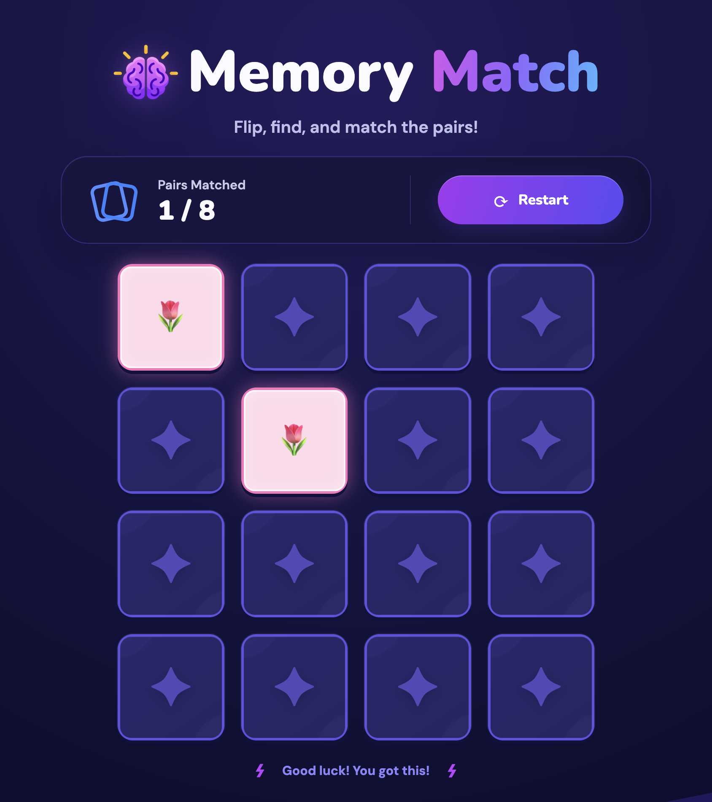

<div align="center">
  
  <h1>Memory Match</h1>
  <p>A colorful, responsive matching game. Flip the cards, find all eight pairs, and reset for another round.</p>
</div>

## Game Preview

<p align="center">
  
</p>

Each round shuffles 16 cards containing eight pairs. The game UI includes a pair counter, a restart control, animated card flips, and pastel reveal colors against an indigo backdrop. The board stays within the viewport on common desktop and mobile screen sizes.

## Features

- Eight shuffled pairs across a four-column, 16-card board.
- Matching cards stay revealed; mismatches turn back over after a short delay.
- Live pair count and game status.
- Restart reshuffles the deck, clears progress, and cancels a pending mismatch timer.
- Keyboard-accessible card buttons with descriptive labels and visible focus indicators.
- Responsive layout, card flip animation, and reduced-motion support.

## Getting Started

Requirements: Node.js and npm.

```bash
npm install
npm start
```

The development server opens at [http://localhost:3000](http://localhost:3000). If that port is already in use, Create React App will offer another available port.

## How to Play

1. Select any card to reveal its symbol.
2. Select a second card. If the symbols match, the pair stays open; otherwise, both cards turn back over after about one second.
3. Continue until all eight pairs are found. Use **Restart** at any time to start a freshly shuffled round.

## Project Structure

```text
src/
  assets/
    game-icon.png       Game title icon
  components/
    GameFooter.js       Completion encouragement
    GameHeader.js       Pair score and restart control
    GameIntro.js        Title and live status announcement
    MemoryBoard.js      Board layout and card list
    MemoryCard.js       Flip state and card presentation
  hooks/
    useMemoryGame.js    Deck, selection, match, and restart logic
  App.js                Composes the screen and connects state to UI
  index.js              React application entry point
  styles.css            Tailwind directives and custom visual styles
tailwind.config.js      Tailwind content paths and theme extensions
```

## Styling

The project uses Tailwind CSS 3 and custom CSS together:

- Tailwind utility classes handle component layout, spacing, grid columns, typography, and responsive breakpoints.
- `tailwind.config.js` scans the `src` files and extends the theme with project colors and font families.
- `src/styles.css` imports Tailwind layers, then defines the game background, viewport-aware sizing, card faces, flip animation, and reduced-motion rules.
- `MemoryCard` assigns a tone class to each symbol; custom CSS uses it to color revealed cards and their outlines.

## Available Scripts

| Command         | Description                                                  |
| --------------- | ------------------------------------------------------------ |
| `npm start`     | Start the development server.                                |
| `npm test`      | Run the Create React App test runner in watch mode.          |
| `npm run build` | Create an optimized production bundle in `build/`.           |
| `npm run eject` | Expose Create React App configuration. This is irreversible. |

## Built With

- React 19
- Create React App (`react-scripts`)
- Tailwind CSS 3
- PostCSS and Autoprefixer
